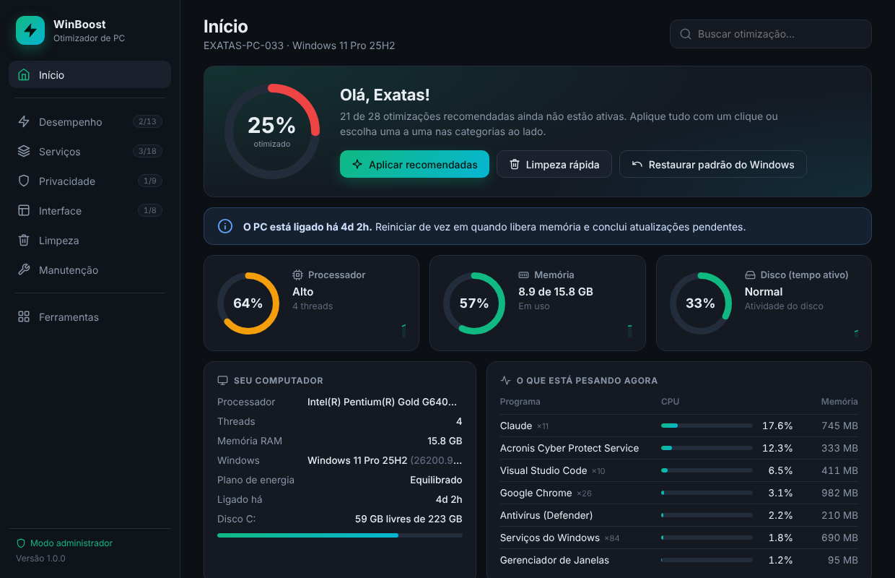

# WinBoost

Otimizador de Windows com interface gráfica — desempenho, serviços, privacidade, interface, limpeza e manutenção, tudo com um clique e **reversível**.

Programa leve (um único `.exe`, sem instalação) escrito em Go com interface em WebView2. Pensado para PCs modestos, onde cada serviço desnecessário faz diferença.



## Recursos

- **Painel ao vivo** — CPU, memória e disco em tempo real e os processos que mais pesam no momento.
- **66 otimizações** divididas em 6 categorias:
  - **Desempenho** — planos de energia, efeitos visuais, prioridade de processos, Game DVR, apps em segundo plano.
  - **Serviços** — desativa serviços desnecessários (SysMain, telemetria, Xbox, indexação, etc.), cada um com liga/desliga.
  - **Privacidade** — telemetria, ID de publicidade, Bing no Iniciar, Copilot, histórico de atividades.
  - **Interface** — Widgets, extensões de arquivo, menu de contexto clássico, Sensor de Armazenamento.
  - **Limpeza** — temporários, cache do Windows Update, Limpeza de Disco, WinSxS, Lixeira.
  - **Manutenção** — ponto de restauração, DISM, SFC, chkdsk, TRIM, saúde do disco, reset de rede.
- **Tudo reversível** — antes de cada mudança o valor original é salvo em `C:\ProgramData\WinBoost\backup.json`. O botão "Restaurar padrão do Windows" desfaz tudo.
- **Transparente** — cada item mostra o nível de risco, se exige reiniciar e eventuais efeitos colaterais. Ponto de restauração criado automaticamente antes de aplicar.
- **Nível de segurança** — nunca mexe no Windows Defender, Windows Update, drivers nem em antivírus/VPNs/softwares de gestão corporativa.

## Download e uso

Baixe o `WinBoost.exe` na página de [**Releases**](../../releases/latest).

1. Dê **dois cliques** no `WinBoost.exe` e aceite o aviso de administrador (o programa precisa disso para alterar serviços e configurações do sistema).
2. Na primeira execução o Windows pode mostrar **"O Windows protegeu o seu computador"** (SmartScreen), porque o `.exe` não é assinado digitalmente. Clique em **Mais informações → Executar assim mesmo**.
3. Alguns antivírus podem sinalizar o programa como suspeito (falso positivo), por ele ser novo, sem assinatura e por mexer em serviços/registro. Se precisar, adicione uma exclusão.

> **Requisito:** Windows 10/11 64-bit com o **WebView2 Runtime** (já vem em praticamente todo Windows 11 e Windows 10 atualizado; se faltar, o próprio programa indica o link de download).

## Compilar a partir do código

Requer [Go](https://go.dev/dl/) 1.24+ e Windows (ou compilação cruzada).

```bash
# Windows (PowerShell/CMD) — gera o ícone, manifesto de administrador e versão:
#   (só precisa rodar se você alterar o ícone ou os metadados)
cd tools
go run gen_resources.go
cd ..

# Compila o executável final (GUI, sem console, otimizado):
go build -trimpath -ldflags "-H windowsgui -s -w" -o WinBoost.exe .
```

Para compilar de outro sistema operacional:

```bash
GOOS=windows GOARCH=amd64 go build -trimpath -ldflags "-H windowsgui -s -w" -o WinBoost.exe .
```

O arquivo `rsrc_windows_amd64.syso` (ícone + manifesto de administrador + versão) já está no repositório, então o build acima funciona direto. Só rode `tools/gen_resources.go` se mudar `icon.png` ou os metadados.

## Como está organizado

| Arquivo | O quê |
|---|---|
| `main.go` | Janela WebView2, pontes JS↔Go, orquestração dos jobs |
| `catalog.go` | Catálogo das 66 otimizações (o que cada uma faz e como reverter) |
| `engine.go` | Motor: registro, serviços, execução de comandos com log ao vivo, backup/restauração |
| `sysinfo.go` | Informações do sistema e estatísticas ao vivo (CPU/RAM/disco/processos) |
| `cp850.go` | Tabela de codificação para ler a saída de comandos em português |
| `ui/index.html` | Interface completa (HTML/CSS/JS, um arquivo só, embutido no `.exe`) |
| `tools/gen_resources.go` | Gera o `.syso` com ícone, manifesto de administrador e versão |

## Aviso

Software fornecido "como está", sem garantias. Mexe em configurações do sistema — embora tudo seja reversível e um ponto de restauração seja criado antes, use por sua conta e risco. Veja a [licença MIT](LICENSE).
